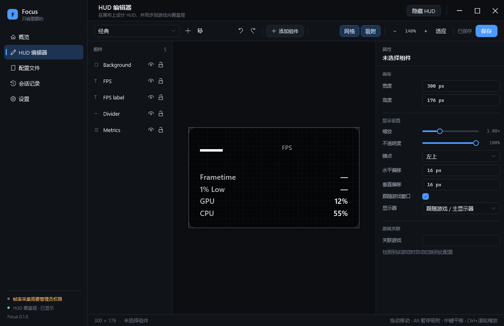
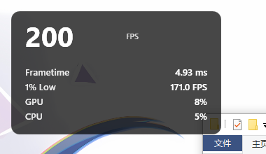

# Focus（焦点）

> **See What Matters.** —— 只看重要的。

Focus 是一款为 Windows 打造的游戏性能监控工具。它把**真实**的帧数据、硬件数据和一块**完全由你设计**的 HUD 放到一起：想知道什么就看什么，想放在哪里就放在哪里，不想看的时候它安静地消失。

它不做的事同样重要：不注入游戏、不挂钩渲染接口、不碰反作弊，也不会用估算值冒充实测值——拿不到的指标就诚实地显示为一个 `—`。



---

## 为什么会做这个

市面上的监控工具通常有两个极端：要么信息堆得很满，要么只能看几个固定数字。

Focus 想解决的问题很朴素：**一局游戏里真正影响体验的，往往只有三五个数字**。1% Low 突然掉下去的那一刻、显存悄悄贴到上限、显卡温度开始爬升——这些才值得被看见。其余的，可以放，也可以不放。

所以 Focus 把"显示什么"和"怎么显示"完全交给你：用一个可视化编辑器画 HUD，实时预览，然后让它在游戏里以透明、鼠标穿透、不抢焦点的方式安静地浮在最上层。

## 它能做什么

**真实的游戏帧数据**

| 指标 | 说明 |
| --- | --- |
| FPS / 平均 FPS | 来自 ETW 的真实 Present 事件，不是采样猜测 |
| 1% Low / 0.1% Low | 最慢 1% / 0.1% 帧的平均帧率，与 RTSS、CapFrameX 口径一致 |
| 帧时间与曲线 | 相邻两帧的时间差，以及最近一段时间的实时曲线 |
| 测试会话 | 开始/停止记录，结束后统计、对比历史会话、导出 CSV |

**硬件与系统**

- GPU：使用率、温度、热点温度、核心/显存频率、功耗、显存占用、风扇转速
- CPU：总体与每个核心的使用率、温度、频率、功耗
- 内存：系统占用、受监控进程的内存占用

数据来自 LibreHardwareMonitor；传感器不存在时显示不可用，不会伪造。

**可以画出来的 HUD**

- 组件：文本、进度条、实时曲线、指标列表、面板、分隔线、图标
- 布局：拖动、缩放、网格、吸附与参考线、多选、对齐、分布、组合、层级、撤销/重做
- 样式：字体字号字重、颜色、透明度、背景、圆角、边框、内边距、数值格式与单位
- 条件颜色：例如 GPU 高于 80°C 时自动变红
- 编辑器的画布与游戏内覆盖层使用同一套渲染代码，所见即所得



**配置与覆盖层**

- 三个内置预设（极简 / 经典 / 专业分析），可以随时复制成自己的配置
- 配置导入导出、与游戏可执行文件关联，检测到游戏时自动切换
- 自动保存 + 原子写入，异常退出也能恢复
- 覆盖层独立进程渲染：透明背景、鼠标穿透、`WS_EX_NOACTIVATE` 不抢焦点、支持多显示器与高 DPI

## 快速开始

**要求**

- Windows 10 22H2 / Windows 11，x64
- [.NET 10 Desktop Runtime](https://dotnet.microsoft.com/download)（或使用自包含发布包）
- **管理员权限**用于 ETW 帧采集；不提权也能用，只是帧指标不可用（界面会明确提示）

**使用**

1. 启动 Focus，按照横幅提示以管理员身份重启。
2. 在「概览」里选择要监控的游戏，或者让 Focus 自动识别正在呈现画面的前台程序。
3. 在「HUD 编辑器」里设计布局，右侧属性面板可以精确到一个小数位。
4. 把配置关联到游戏，下次启动游戏时会自动加载。
5. 想认真测一局时，开始一次「测试会话」，结束后在「会话记录」里回顾曲线、对比历史、导出 CSV。

**默认快捷键**（可在设置中重新录制）

| 快捷键 | 功能 |
| --- | --- |
| `Ctrl + Alt + H` | 显示 / 隐藏 HUD |
| `Ctrl + Alt + R` | 开始 / 停止会话记录 |
| `Ctrl + Alt + L` | 切换配置文件 |

## 数据放在哪里

```
%AppData%\Focus\
├── settings.json     应用设置（保留上一份备份）
├── profiles\         你创建的 HUD 配置（*.json）
├── sessions\         测试会话（*.fss，压缩二进制，只存实测帧时间）
└── logs\             运行日志
```

删除这个目录即可完全重置；不会写入注册表（除 Windows 常规的窗口位置等系统行为外）。

## 关于兼容性，需要说清楚的

- **推荐无边框窗口化**。独占全屏（Exclusive Fullscreen）由游戏独占显示输出，普通置顶窗口无法叠加，此时 HUD 不显示——但帧采集仍然有效。
- 不注入、不挂钩、不规避反作弊。个别游戏的反作弊可能限制任何覆盖层或 ETW 工具，这种情况下请不要在该游戏中使用。
- 无法获取的指标显示为 `—`，不使用估算值。
- Windows 10 22H2 上已完成实机验证；Windows 11、多显示器与高 DPI、真实游戏内的叠加行为仍待更多测试。

更完整的兼容性说明见 [docs/COMPATIBILITY.md](docs/COMPATIBILITY.md)。

## 它是怎么做的

```
Telemetry   ETW（DxgKrnl Present 事件）+ LibreHardwareMonitor + 系统指标
Metrics     帧时间线、统计口径、历史缓存
Hud         组件模型、渲染内核（编辑器与覆盖层共用）
Overlay     独立进程：透明、穿透、不抢焦点、按显示器 DPI 定位
Editor      画布、属性面板、撤销重做、实时预览
Profiles    配置、预设、游戏关联、导入导出
App         主程序、托盘、快捷键、会话与设置
```

主程序与覆盖层是两个进程，通过共享内存传递状态快照。覆盖层崩溃不会拖垮主程序，主程序繁忙也不会卡住 HUD。

架构决策与取舍记录在 [docs/DECISIONS.md](docs/DECISIONS.md)，开发进度与已知问题在 [PROGRESS.md](PROGRESS.md)。

## 从源码构建

```bash
git clone https://github.com/AvroraCL/Focus.git
cd Focus
dotnet build src/Focus.App/Focus.App.csproj -c Release
```

运行：

```bash
dotnet run --project src/Focus.App
```

打包发布（主程序 + 覆盖层 + zip）：

```powershell
powershell -ExecutionPolicy Bypass -File build.ps1
# 自包含版本（目标机器无需安装 .NET 运行时）
powershell -ExecutionPolicy Bypass -File build.ps1 -SelfContained
```

产物位于 `artifacts/publish/app`，压缩包为 `artifacts/publish/Focus-v0.0.1-win-x64.zip`。

运行单元测试：

```bash
dotnet test tests/Focus.Tests/Focus.Tests.csproj
```

## 当前版本：v0.0.1

这是第一个可以实际使用的版本，已经做到：

- 管理员权限下的真实 FPS / 帧时间 / 1% Low 采集与实机验证
- 独立覆盖层在桌面上实时渲染真实数值
- 完整的可视化编辑器与配置、会话、预设、双语界面
- 26 项单元测试覆盖统计口径、会话文件、配置序列化、条件颜色与进程间通信

还需要更多真实环境验证的内容（见 [PROGRESS.md](PROGRESS.md)）：真实游戏内的叠加行为、独占全屏、多显示器 / 高 DPI、长时间运行稳定性、安装包。

版本之间的改动记录在 [CHANGELOG.md](CHANGELOG.md)。

## 第三方

- [LibreHardwareMonitor](https://github.com/LibreHardwareMonitor/LibreHardwareMonitor)（MPL-2.0）—— 硬件传感器
- [Microsoft.Diagnostics.Tracing.TraceEvent](https://github.com/microsoft/perfview)（MIT）—— ETW 消费

Focus 不包含任何来自 PresentMon、RTSS 或 CapFrameX 的代码，帧数据直接来自 Windows 的 ETW 事件。

## 许可证

本项目目前未附带开源许可证。如果你希望复用其中的代码，请先联系作者。

---

如果 Focus 帮到了你，欢迎提 issue 或者点一个 star；如果它哪里做得不好，也请直接说。
