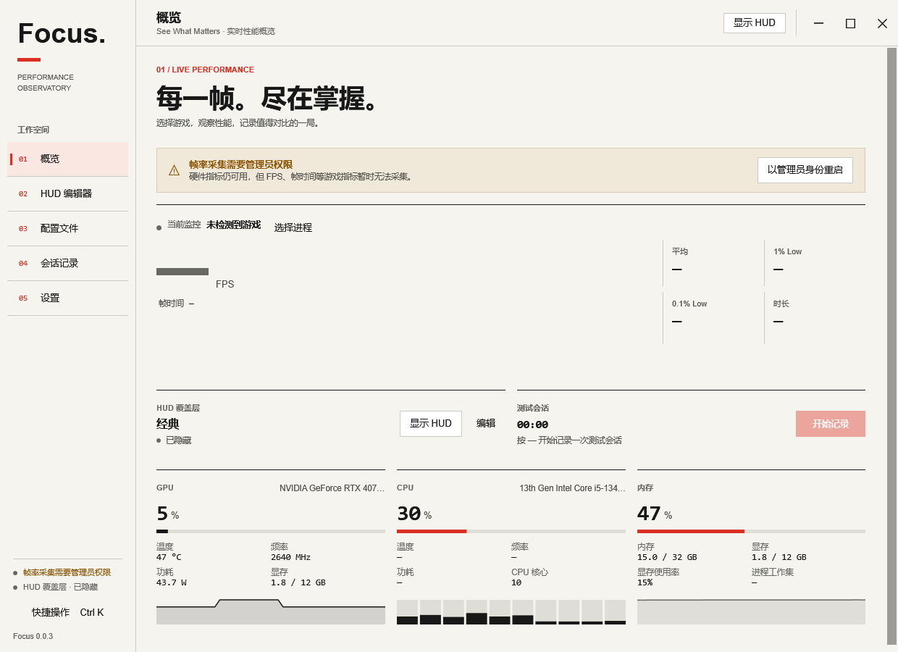
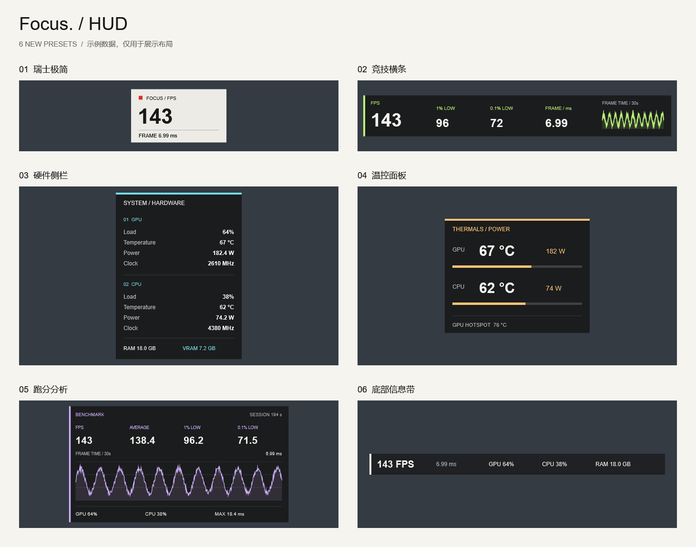
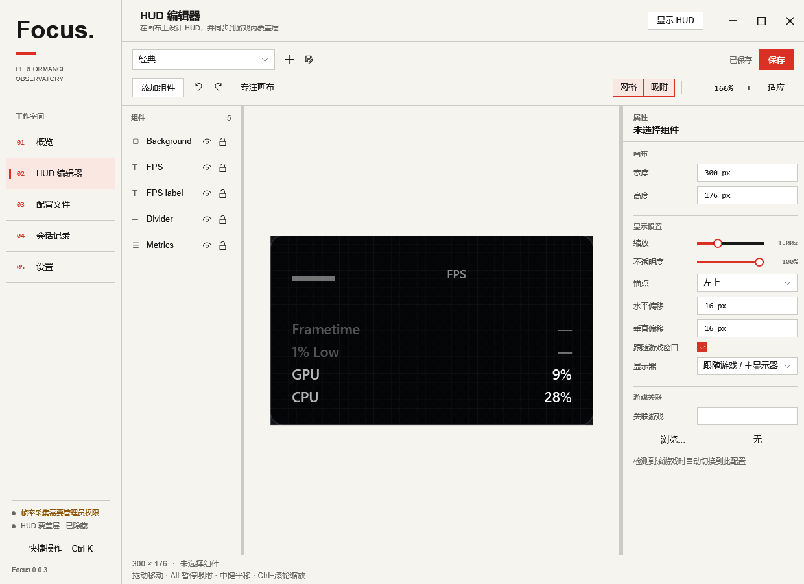

<div align="center">


# Focus · 焦点

[](https://github.com/AvroraCL/Focus/releases)
[](https://github.com/AvroraCL/Focus)
[](src/Focus.App)
[](rust/focus-native)
[](LICENSE)

**See What Matters. / 只看重要的。**

面向 Windows 玩家的游戏性能监控与可视化 HUD 工作台

</div>

Focus 将游戏帧数据、硬件传感器、可自由编排的 HUD 和测试会话放进一个桌面应用。选中游戏，挑一套预设，或自己设计布局；把需要的数字放到屏幕边缘，记录一局，再回来看帧时间和低帧表现。界面采用 WPF，统计与原子文件写入由 Rust 核心承担，采集数据和配置保存在本机。

**[下载已发布的 Windows 版](https://github.com/AvroraCL/Focus/releases/latest)** · [查看 HUD 预设](#hud-预设) · [更新日志](CHANGELOG.md) · [反馈问题](https://github.com/AvroraCL/Focus/issues)

> **v0.0.3** 带来瑞士风格界面、Rust 核心、6 套新增 HUD 和自动更新客户端。从 v0.0.2 首次升级请手动下载并解压新版。



从一局游戏到一份记录：**选择进程** → **应用或编辑 HUD** → **记录测试会话** → **查看帧时间、对比结果、导出 CSV**。上图为实际桌面界面；未选择游戏、未获得帧采集权限时，帧指标显示为 `—`。

## 面向用户

### Focus 能做什么

- **帧率与帧时间**：通过 Windows ETW 的 Present 事件获取 FPS、平均 FPS、1% Low、0.1% Low 与帧时间历史，观察帧间隔波动。
- **硬件与系统监测**：显示 GPU / CPU 使用率、温度、频率、功耗，以及显存、内存和进程内存；具体项目取决于硬件与驱动提供的传感器。
- **可视化 HUD 编辑**：组合文本、进度条、曲线、指标列表、面板、分隔线和图标；支持拖动、多选、对齐、网格吸附、分组、撤销与重做。
- **9 套内置预设**：从极简帧率到完整跑分面板，一键使用，也可以复制成自己的配置。字体、颜色、单位、透明度、条件变色和默认位置均可编辑。
- **游戏配置关联**：导入 / 导出 JSON，为配置关联游戏可执行文件；检测到对应游戏时切换布局。
- **独立覆盖层**：透明、鼠标穿透、不抢焦点，支持锚点、偏移和缩放；编辑器与覆盖层共用 HUD 渲染器。
- **测试会话**：开始 / 停止录制，保存原始帧间隔，查看统计与卡顿尖峰、对比历史会话、导出 CSV。
- **桌面交互**：系统托盘、全局快捷键、中英文界面、`Ctrl+K` 快捷操作、配置和会话搜索、专注画布模式。
- **更新检查**：支持启动时检查 GitHub 正式版，可取消下载、SHA-256 校验，以及退出后的文件替换与失败回滚。安装由用户点击执行。

### 下载与版本

| 版本 | 获取方式 | 说明 |
| --- | --- | --- |
| v0.0.3 | [Focus-v0.0.3-win-x64.zip](https://github.com/AvroraCL/Focus/releases/download/v0.0.3/Focus-v0.0.3-win-x64.zip) | 解压后运行 Focus.exe，需要 .NET 10 Desktop Runtime |

校验文件：[Focus-v0.0.3-win-x64.zip.sha256](https://github.com/AvroraCL/Focus/releases/download/v0.0.3/Focus-v0.0.3-win-x64.zip.sha256)。可使用 PowerShell `Get-FileHash -Algorithm SHA256` 核对下载文件。

完整版本记录见 [Releases](https://github.com/AvroraCL/Focus/releases) 和 [CHANGELOG.md](CHANGELOG.md)。

### 系统要求

- Windows 10 22H2 或 Windows 11，**x64**。Windows 11 的完整兼容性仍待实测。
- [.NET 10 Desktop Runtime](https://dotnet.microsoft.com/en-us/download/dotnet/10.0)；自行构建的自包含包无需另外安装运行时。
- ETW 帧采集需要管理员权限。普通权限可以打开界面并读取可用的硬件指标，界面会提示如何提权。
- 建议使用游戏的**无边框窗口化**模式，让桌面覆盖层正常叠加。

运行发布包不需要安装 Rust、编译器或开发工具。

### 安装与使用

1. 下载 ZIP，**完整解压**到一个目录，保留 `overlay/` 和其他随包文件，再启动 `Focus.exe`。
2. 要监测游戏帧率时，点击概览页的“以管理员身份重启”。
3. 启动游戏，在概览页选择对应进程，或等待自动识别。
4. 打开“配置文件”，选择内置预设；也可以进入“HUD 编辑器”调整组件和位置。
5. 显示 HUD。需要复盘时开始记录，结束后在“会话记录”中查看统计、曲线和导出结果。

“使用预设”直接应用布局；“编辑”会创建可修改副本。关闭窗口默认收回托盘，完全退出请使用托盘菜单。

### HUD 预设



上图使用示例数据展示布局，**不是游戏实测结果**。实际覆盖层只显示采集得到的指标。

| 预设 | 适合查看 | 默认位置 |
| --- | --- | --- |
| 极简 | FPS 与帧时间 | 左上角 |
| 经典 | 帧率、低帧和 GPU / CPU 负载 | 左上角 |
| 专业分析 | 帧时间曲线与详细性能指标 | 左上角 |
| 瑞士极简 | 纸白底、黑色帧率与红色焦点 | 左上角 |
| 竞技横条 | FPS、双低帧指标与 30 秒趋势 | 顶部居中 |
| 硬件侧栏 | 负载、温度、功耗、频率与内存 | 右上角 |
| 温控面板 | GPU / CPU 温度、功耗与热点温度 | 右下角 |
| 跑分分析 | 平均帧率、双低帧、曲线与会话时长 | 左下角 |
| 底部信息带 | 44 px 高的轻量信息带 | 底部居中 |

尺寸、提示阈值与导出方法见 [HUD 预设说明](docs/HUD-PRESETS.md)。

<details>
<summary>查看 HUD 编辑器</summary>



画布支持布局编辑、网格吸附、条件颜色和精确属性输入；专注画布模式可以暂时收起两侧面板。

</details>

### 快捷键

| 快捷键 | 功能 | 范围 |
| --- | --- | --- |
| `Ctrl + Alt + H` | 显示 / 隐藏 HUD | 全局，可在设置中修改 |
| `Ctrl + Alt + R` | 开始 / 停止记录 | 全局，可在设置中修改 |
| `Ctrl + Alt + L` | 切换配置 | 全局，可在设置中修改 |
| `Ctrl + K` | 打开快捷操作 | 主窗口 |
| `Alt + 1` … `Alt + 5` | 切换五个页面 | 主窗口 |
| `Ctrl + Shift + F` | 切换专注画布 | HUD 编辑器 |

### 本地数据与更新

```text
%AppData%\Focus\
├── settings.json          应用设置
├── settings.backup.json   上一份有效设置备份
├── profiles\              自定义 HUD（JSON）
├── sessions\              测试会话（FSS1 压缩文件）
├── logs\                  运行日志
└── updates\               更新下载、安装任务与文件备份
```

设置页可打开数据目录或复制诊断信息。配置与会话在本地保存，原子文件替换降低写入中断造成的损坏风险。

默认在启动后检查更新，也可以关闭自动检查。下载成功并校验后，点击“重启并安装”；录制期间不能安装，安装前会保存待保存的编辑内容。更新来源、文件格式和回滚边界见 [自动更新说明](docs/AUTO-UPDATE.md)。

### 当前状态与已知限制

- **Present 事件不等于显示端实际呈现帧**。当前按进程聚合，尚未区分同一进程中的多个交换链。
- 普通置顶窗口不能叠加到独占全屏画面；推荐无边框窗口化。具体游戏与反作弊软件的兼容性需逐项验证。
- 指标缺失时显示 `—`；CPU 温度、功耗或某些 GPU 传感器可能因硬件、权限或驱动而不可用。
- 实时低帧统计基于最近最多 60,000 个 Present；录制统计基于已保存会话。单次会话当前最多记录 8,000,000 个帧间隔。
- 已通过 62 项 .NET 测试、WPF 交互检查、预设渲染检查和本地更新流程验证；客户端公网升级、安装向导、长时间运行、Windows 11、多显示器 / 高 DPI 与更多真实游戏环境仍待验证。

具体边界见 [兼容性说明](docs/COMPATIBILITY.md)、[Rust 迁移说明](docs/RUST-MIGRATION.md) 和 [开发进度](PROGRESS.md)。

---

## 面向开发者

### 设计原则与技术栈

**数据保持真实，界面负责表达，核心逻辑只有一份实现。**

- **WPF / .NET 10**：桌面界面、编辑器、系统托盘、快捷键与 Windows 集成。
- **Rust / C ABI**：帧时间线、环形缓存、统计计算与原子写入；C# 通过 SafeHandle 管理核心对象。
- **ETW / TraceEvent**：消费游戏进程的 Present 事件。
- **LibreHardwareMonitor**：读取硬件传感器，由托管适配层提供给指标系统。
- **独立 Overlay 进程**：通过共享内存接收快照；编辑器与覆盖层共用 `Focus.Hud` 渲染器。
- **独立 Updater 进程**：校验、准备更新、等待主程序退出、备份与替换文件。

原始帧间隔用于统计，图表历史单独采样。采集、统计、HUD 和 UI 的职责边界见 [架构决策](docs/DECISIONS.md)。

### 开发环境

- Windows x64、Git、**.NET 10 SDK**。
- **PowerShell 7**，确保 `pwsh` 在 PATH 中。
- **Rust 工具链**（最低 Rust 1.82），安装 `x86_64-pc-windows-gnu` target。
- 可用于 Windows x64 的 **MinGW-w64 / GNU 链接工具链**，并配置到 PATH。当前构建脚本固定使用 GNU target。
- 可选：Inno Setup 6，用于编译安装程序；安装流程尚未完成本次验证。

### 从源码构建

```powershell
git clone https://github.com/AvroraCL/Focus.git
cd Focus
rustup target add x86_64-pc-windows-gnu
dotnet build Focus.slnx -c Release
dotnet run --project src/Focus.App/Focus.App.csproj -c Release
```

MSBuild 会调用 `build-native.ps1`，生成并复制 `focus_native.dll`。GNU 链接器的中间产物放在临时目录的 ASCII 路径下，以兼容中文仓库路径。不要把其他架构的 DLL 混入 x64 输出。

如果 PATH 指向没有 SDK 的 x86 `dotnet`，请使用 `C:\Program Files\dotnet\dotnet.exe`。

### 构建与打包

```powershell
# 框架依赖版：目标机器需要 .NET 10 Desktop Runtime
pwsh -File build.ps1

# 自包含版：随包携带运行时
pwsh -File build.ps1 -SelfContained

# 可选安装程序（先完成上面的发布）
iscc installer/Focus.iss
```

`build.ps1` 发布主程序、覆盖层与更新程序，输出到 `artifacts/publish/`：

```text
artifacts/publish/
├── app/                             可运行目录，包含 overlay/ 与 updater/
├── Focus-v0.0.3-win-x64.zip           分发包
└── Focus-v0.0.3-win-x64.zip.sha256    SHA-256 校验文件
```

发布时将 ZIP 和校验文件一起上传到对应 GitHub Release。版本维护在 `Directory.Build.props` 和 `rust/focus-native/Cargo.toml`；安装器从应用产物读取版本。许可证与第三方说明随应用目录和 ZIP 一起分发。

### 测试与预览

```powershell
dotnet test tests/Focus.Tests/Focus.Tests.csproj -c Release
pwsh -File build-native.ps1 -Test
pwsh -File build-native.ps1 -Lint

# WPF 快捷操作与编辑器交互检查
dotnet run --project docs/tools/UiCheck/UiCheck.csproj -c Release -- artifacts/ui-preview

# 预设边界、文字尺寸、空数据渲染及 PNG / JSON 导出
dotnet run --project docs/tools/PresetPreview/PresetPreview.csproj -c Release -- artifacts/hud-presets

# 隔离目录中的更新程序端到端验证
dotnet run --project docs/tools/UpdateCheck/UpdateCheck.csproj -c Release -- src/Focus.Updater/bin/Release/net10.0-windows artifacts/update-check
```

HUD 展示图使用专门的示例数据源，游戏内覆盖层不使用该数据源。运行截图工具时可设置 `FOCUS_DATA_ROOT` 隔离数据，设置 `FOCUS_INSTANCE` 隔离进程间通信；详见 [UI 设计与验证](docs/UI-REDESIGN.md)。

### 目录结构

```text
rust/focus-native/       Rust 时间线、统计、原子写入与 C ABI
src/Focus.Core/         数据模型、序列化、Rust 适配、IPC 与更新协议
src/Focus.Telemetry/    ETW、硬件采集、游戏检测与会话录制
src/Focus.Hud/          HUD 渲染器、数值格式与内置预设
src/Focus.App/          WPF 主窗口、编辑器、设置、托盘与交互
src/Focus.Overlay/      独立透明覆盖层
src/Focus.Updater/      独立更新程序
tests/Focus.Tests/     核心与集成回归测试
docs/                  设计、兼容性、更新协议、截图与验证工具
installer/             Inno Setup 安装脚本
```

### 参与开发

欢迎通过 [Issues](https://github.com/AvroraCL/Focus/issues) 提交问题与建议。反馈采集问题时，请附上 Windows 版本、游戏显示模式、权限状态、复现步骤，以及设置页复制出的诊断信息；分享前可自行删去路径或进程名等私人信息。

提交改动时请保持 Rust 统计核心、采集适配和 WPF 界面的职责边界，并运行与改动相关的检查。不要用示例数据填补实际采集缺失，也不要把未验证的平台兼容性描述为已经通过。

## 第三方与致谢

- [LibreHardwareMonitor](https://github.com/LibreHardwareMonitor/LibreHardwareMonitor)：硬件传感器，MPL-2.0。
- [Microsoft.Diagnostics.Tracing.TraceEvent](https://github.com/microsoft/perfview)：ETW 事件消费，MIT。
- [.NET / WPF](https://github.com/dotnet/wpf) 与 [Rust](https://www.rust-lang.org/)：桌面与核心运行基础。

其他依赖及原作者说明见 [THIRD_PARTY_NOTICES.md](THIRD_PARTY_NOTICES.md)。

## 许可证

Focus 原创代码采用 [MIT License](LICENSE)，Copyright © 2026 AvroraCL。允许使用、修改和分发；再分发时保留版权与许可声明。第三方组件继续遵循各自许可证。
